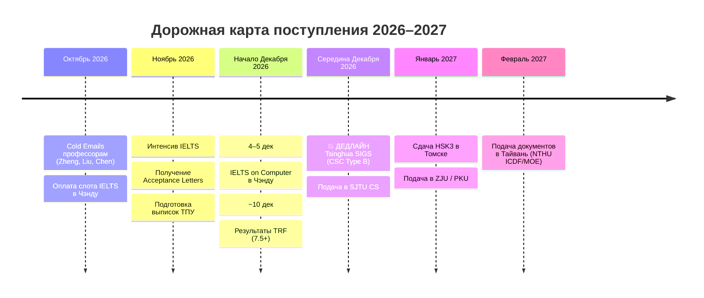

# 🎓 Master's Preparation 2027 & IELTS Portfolio

> **Студент:** Денис Штэпа (ТПУ, ИШИТР, 4 курс, Программная инженерия)  
> **Роль:** Platform / Technical PM, System Designer & Team Lead (Archon, OmniSearch, Т-Банк, Газпром нефть)  
> **Главная цель:** Поступление в магистратуру на **Fall 2027 с полным грантом**:
> 1. 🇨🇳 **Приоритет №1:** Китай **CSC Type B** (Tsinghua SIGS Data Science & IT, PKU SEI, SJTU, ZJU) — дедлайны: **декабрь 2026**
> 2. 🇹🇼 **Приоритет №2:** Тайвань **ICDF / MOE** (NTHU IMBA/IMPISA) — дедлайны: **февраль 2027**
> 
> 🎯 **Ближайший майлстоун:** **IELTS on Computer в Чэнду (Китай)** — 4–5 декабря 2026 (цель: **7.5+**).

---

## ⚡ Экспресс-навигатор: что делать прямо сейчас

| Задача | Где лежит / Что открыть | Детали |
| :--- | :--- | :--- |
| **1. IELTS Academic в Чэнду** | ✅ **Забронировано и оплачено** | 5 декабря 2026 (Sichuan University IOC, e-TRF: 6–10 дек). |
| **2. Экспортировать CV в PDF** | [`admission/cv/cv_en.html`](file:///Users/shteppinson/mylife/maga/admission/cv/cv_en.html) | Открыть в браузере → `Cmd+P` → Save as PDF (`Denis_Shtepa_CV.pdf`). |
| **3. Отправить Письмо №1 профессору** | [`admission/october_action_plan_2026.md`](file:///Users/shteppinson/mylife/maga/admission/october_action_plan_2026.md) | Prof. Zheng Haitao (Tsinghua SIGS). Отправка утром (04:00–06:00 МСК+4). |
| **4. Заказать выписку в деканате ТПУ** | Деканат ИШИТР ТПУ | Выписка за 3 курса с расчетом GPA и печатью. |

---

## 📁 Структура репозитория

```text
maga/
├── README.md                      # Этот файл (навигатор и карта репозитория)
├── AGENTS.md                      # Инструкции и правила для ИИ-агентов
│
├── 📂 admission/                  # ВСЁ ПО ПОСТУПЛЕНИЮ И ГРАНТАМ
│   ├── october_action_plan_2026.md# ⚡ ОПЕРАЦИОННЫЙ ПЛАН: письма, шаги на неделю
│   ├── asia_apply_tracker_2027.md # 📊 Мастер-трекер всех вузов, грантов и дедлайнов
│   ├── professors_shortlist_2027.md# Шортлист профессоров, лабораторий и их статей
│   ├── letters_drafts_2027.md     # Шаблоны писем профессорам (волны 1–3) и ответов
│   │
│   ├── 📂 cv/                     # Резюме и карьерные материалы
│   │   ├── cv_en.html             # ⭐️ ЕДИНСТВЕННЫЙ ИСТОЧНИК CV (Research CV -> PDF)
│   │   ├── cv_en.md               # Зеркало резюме в Markdown
│   │   ├── career_portfolio_cheatsheet.md # 🎯 Шпаргалка: STAR-кейсы, цифры и метрики
│   │   └── 📂 archive/            # Архив старых корпоративных резюме (PM, SA)
│   │
│   ├── 📂 study_plans/            # Мотивационные письма и планы исследований
│   │   ├── csc_study_plan_2027_personalized.md # План исследований для Tsinghua SIGS
│   │   ├── csc_study_plan_2027.md # Мастер-шаблон Study Plan для CSC (800+ слов)
│   │   └── gks_essays_2027.md     # Мотивационные эссе для корейского гранта GKS
│   │
│   ├── 📂 guides/                 # Пошаговые инструкции и шпаргалки
│   │   ├── universities_shortlist_cheat_sheet.md # 🏛 Шпаргалка программ, грантов и кодов вузов
│   │   ├── docs_legalization_cn_tw_kr.md # Легализация: апостиль, переводы, TECO
│   │   ├── visa_finances_cn_tw_kr.md     # Визы, справки о финансах, подработки
│   │   └── universities_campus_guide_2027.md # Гайд по кампусам и условиям
│   │
│   └── 📂 hsk/                    # Подготовка к китайскому языку
│       ├── chinese_hsk_plan_0_to_4.md    # Стратегия HSK 0 -> HSK 4
│       ├── hsk3_logistics_tomsk.md       # Сдача HSK3 в Институте Конфуция ТПУ
│       └── 📂 textbooks/                 # Учебники HSK Standard Course и NPCR
│
├── 📂 ielts/                      # ПОДГОТОВКА К IELTS (Сдача 4–5 дек 2026, Чэнду)
│   ├── diagnostic_tracker.md      # 📈 Трекер баллов, срезов и калибровки (L/R/W/S)
│   ├── ielts_plan_6_weeks.md      # 6-недельный план подготовки до вылета
│   │
│   ├── 📂 cheat_sheets/           # 📝 Шпаргалки по IELTS
│   │   ├── writing_task2_master_guide.md # Гайд и клише по Writing Task 2
│   │   ├── bedtime_review_cheat_sheet.md # Каркас связок для вечернего повторения
│   │   └── three_day_sprint_protocol.md  # Протокол 3-дневного спринта
│   │
│   ├── 📂 flight_pack/            # Офлайн-материалы для самолета и поездки
│   │   ├── 01_ultimate_ielts_handbook.md
│   │   ├── 02_writing_templates_and_models.md
│   │   └── 03_offline_drills_with_keys.md
│   │
│   └── 📂 drills/                 # Практические упражнения
│       └── 01_reading_tfng.md     # Разбор True / False / Not Given
│
└── 📂 projects/                   # ПОРТФОЛИО И АРХИТЕКТУРНЫЕ КЕЙСЫ
    ├── archon_product_log.md      # 📝 Еженедельный лог PM-решений (STAR)
    ├── archon_shtepa.md           # Дипломный проект Archon (полный техпроект)
    ├── archon_product-overview.md # Архитектурный обзор Archon
    ├── omnisearch.md              # RAG-система видеопоиска (Газпром Восток Нефть)
    ├── archmap.md                 # Генератор C4-архитектуры (Т-Банк)
    └── crdt_shtepa.md             # Исследование алгоритмов CRDT
```

---

## 📌 Ключевые дедлайны



---

## 💡 Полезные команды

* **Открыть актуальное резюме в браузере для печати:**
  ```bash
  open admission/cv/cv_en.html
  ```
* **Просмотреть операционный план на сегодня:**
  [admission/october_action_plan_2026.md](file:///Users/shteppinson/mylife/maga/admission/october_action_plan_2026.md)
