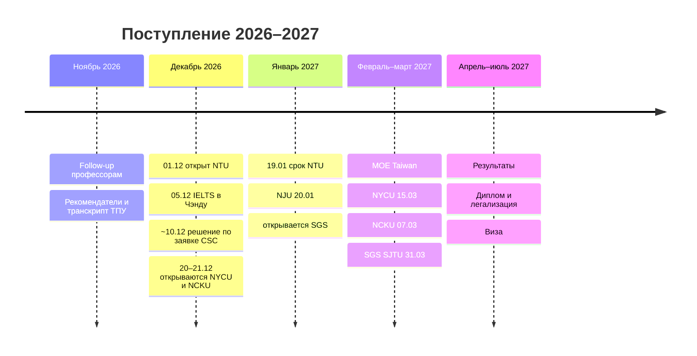

# 🎓 Master's Preparation 2027 & IELTS Portfolio

> **Студент:** Денис Штэпа (ТПУ, ИШИТР, 4 курс, Программная инженерия)  
> **Роль:** Platform / Technical PM, System Designer & Team Lead (Archon, OmniSearch, Т-Банк, Газпром нефть)  
> **Главная цель:** магистратура на **осень 2027 с грантом**, главное поступить. Трекер: [`admission/README.md`](admission/README.md)
> 1. 🇹🇼 **Тайвань (чуть выше):** 🇹🇼 NTU CSIE, 🇹🇼 NYCU CS, 🇹🇼 NTHU, 🇹🇼 NCKU — стипендии вузов / MOE. Первый срок: **🇹🇼 NTU 19.01.2027**
> 2. 🇨🇳 **Китай:** **1 заявка CSC Type B** (вуз по ответу профессора, решение ~10.12) + 🇨🇳 SJTU через стипендию Шанхая (SGS)
>
> 🎯 **Ближайший майлстоун:** **IELTS on Computer в Чэнду (Китай)** — 5 декабря 2026, суббота (цель: **7.5+**).

---

## ⚡ Экспресс-навигатор

| Задача | Где |
| :--- | :--- |
| Что делать сейчас по поступлению | [`admission/README.md`](admission/README.md), раздел 0 |
| IELTS 05.12, Чэнду (оплачено) | [`ielts/diagnostic_tracker.md`](ielts/diagnostic_tracker.md) |
| Письма профессорам и follow-up | [`admission/letters_2027.md`](admission/letters_2027.md) |
| CV → PDF | `admission/cv/cv_en.html` → `Cmd+P` → `Denis_Shtepa_CV.pdf` |

---

## 📁 Структура репозитория

```text
maga/
├── README.md                      # Этот файл (навигатор и карта репозитория)
├── MASTER_SUMMARY.md              # 📋 Единый саммари-файл (профиль, вузы, проекты, IELTS)
├── AGENTS.md                      # Инструкции и правила для ИИ-агентов
│
├── 📂 admission/                  # ВСЁ ПО ПОСТУПЛЕНИЮ И ГРАНТАМ
│   ├── README.md                  # 📊 Главный трекер: стратегия, вузы, сроки, деньги, статусы
│   ├── professors_shortlist_2027.md # Профессора, лаборатории, публикации
│   ├── letters_2027.md            # Отправленные письма, follow-up, рекомендатели, ответы
│   ├── 📂 cv/                     # cv_en.html (источник CV) → PDF, шпаргалка цифр, CV для работы
│   ├── 📂 study_plans/            # Мастер-шаблон + версии Tsinghua / PKU
│   ├── 📂 guides/                 # Легализация, финансы и визы, кампусы
│   └── 📂 hsk/                    # План китайского, HSK3 в Томске, учебники
│
├── 📂 ielts/                      # ПОДГОТОВКА К IELTS (Сдача 4–5 дек 2026, Чэнду)
│   ├── diagnostic_tracker.md      # 📈 Трекер баллов, срезов и калибровки (L/R/W/S)
│   ├── ielts_plan_6_weeks.md      # 6-недельный план подготовки до вылета
│   │
│   ├── 📂 cheat_sheets/           # 📝 Шпаргалки по IELTS
│   │   ├── writing_task2_master_guide.md # Гайд и клише по Writing Task 2
│   │   ├── bedtime_review_cheat_sheet.md # Каркас связок для вечернего повторения
│   │   └── three_day_sprint_protocol.md  # Протокол 3-дневного спринта
│   │
│   ├── 📂 flight_pack/            # Офлайн-материалы для самолета и поездки
│   │   ├── 01_ultimate_ielts_handbook.md
│   │   ├── 02_writing_templates_and_models.md
│   │   └── 03_offline_drills_with_keys.md
│   │
│   └── 📂 drills/                 # Практические упражнения
│       └── 01_reading_tfng.md     # Разбор True / False / Not Given
│
└── 📂 projects/                   # ПОРТФОЛИО И АРХИТЕКТУРНЫЕ КЕЙСЫ
    ├── archon_product_log.md      # 📝 Еженедельный лог PM-решений (STAR)
    ├── archon_shtepa.md           # Дипломный проект Archon (полный техпроект)
    ├── archon_product-overview.md # Архитектурный обзор Archon
    ├── omnisearch.md              # RAG-система видеопоиска (R&D, обмен опытом с Газпром Восток Нефть)
    ├── archmap.md                 # Генератор C4-архитектуры (Т-Банк)
    └── crdt_shtepa.md             # Исследование алгоритмов CRDT
```

---

## 📌 Ключевые даты


